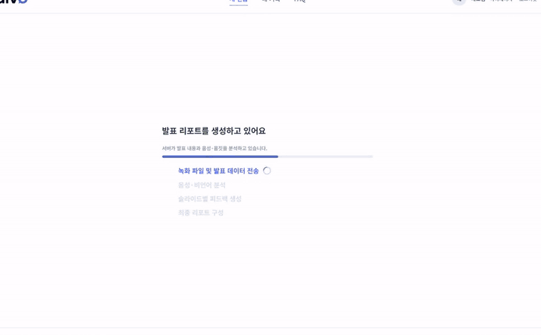
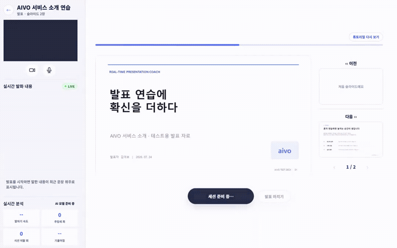
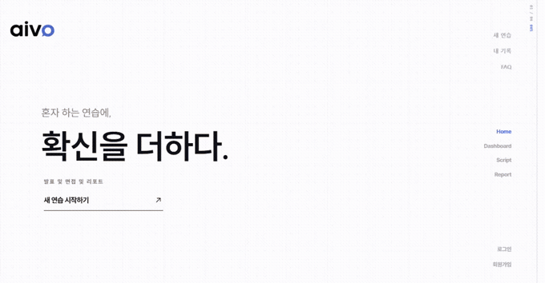

# AIVO

<p align="center"></p>



발표, 면접 연습을 녹화하고 음성, 몸짓, 내용에 대한 피드백을 확인하는 AI 코칭 서비스입니다. SSAFY 팀 프로젝트의 프론트엔드와 백엔드 코드를 공개용으로 정리했습니다.

## 발표 연습에서 리포트까지

발표를 시작하고 슬라이드를 넘긴 뒤, 연습을 마치면 결과 요약과 슬라이드별 상세 리포트를 열 수 있습니다. 실제 AIVO 프런트엔드를 로컬에서 실행한 영상입니다. 카메라, 마이크에는 가상 입력을 사용했고, 분석 점수, 발화 내용, 피드백은 테스트 데이터입니다.



[영상 보기 (MP4)](https://raw.githubusercontent.com/Seogaeun03/aivo/main/assets/presentation-practice.mp4)

## AIVO 연습 화면 둘러보기

홈의 학습 추이와 대본 복기 예시를 살펴보고 발표, 면접 연습 선택 화면으로 이동합니다.



[녹화 원본 보기 (MP4)](https://raw.githubusercontent.com/Seogaeun03/aivo/main/assets/service-tour.mp4)

## 주요 흐름

연습 유형 선택 → 자료, 질문 준비 → 카메라, 마이크 확인 → 연습 녹화 → 분석 결과와 리포트 확인 → 폴더별 기록 조회

## 기술과 코드 구성

| 영역 | 기술 | 코드 |
|---|---|---|
| 프론트엔드 | Vue 3, Pinia, Vue Router, Vite | [frontend-vue-main/src](frontend-vue-main/src) |
| 서비스 API | Java, Spring Boot, JPA, JDBC, PostgreSQL | [backend-spring-develop/src](backend-spring-develop/src) |
| 분석 서버와 작업 처리 | Python, FastAPI, RabbitMQ | [backend-fastapi-main/app](backend-fastapi-main/app) |
| 브라우저 분석 | MediaPipe, Web Audio | 프론트엔드의 composables와 연습 화면 |

버전과 의존성은 각 모듈의 package.json, build.gradle, requirements.txt를 따릅니다. 팀 전체 코드를 포함하며 아래 개인 역할과 구분합니다.

## 서가은의 역할

- 프론트엔드 화면 흐름과 수정 기준을 구체화하고 실제 화면을 검수했습니다.
- 면접, 폴더 API 연결에서 Mock 응답과 실제 서버 응답을 구분하며 명세와 요청 결과를 대조했습니다.
- 리포트의 전체 집계와 질문별 근거가 맞지 않는 문제를 발견하고 표시 기준을 점검했습니다.
- AI와 구현을 협업하며 화면, 서버 응답을 확인했습니다. 백엔드와 AI 모델 전체를 개인 구현으로 주장하지 않습니다.

대표 경험은 [AIVO 사례](docs/CASE_STUDY.md)에 정리했습니다.

## 실행 준비

### Vue 프론트엔드

```sh
cd frontend-vue-main
npm ci
npm run dev
```

설정이 필요하면 `.env.example`을 `.env`로 복사해 로컬 API 주소를 지정합니다. 카메라, 마이크 기능은 브라우저 권한이 필요합니다.

```sh
npm test
npm run build
```

### Spring 서비스 API

빌드 파일의 Java toolchain은 **25**입니다. PostgreSQL, Redis, RabbitMQ와 외부 API, 스토리지 접근 정보를 환경변수로 설정한 뒤 실행합니다. 변수 이름은 [application.yml](backend-spring-develop/src/main/resources/application.yml)에 있습니다.

```sh
cd backend-spring-develop
./gradlew bootRun
```

Windows에서는 `gradlew.bat bootRun`을 사용합니다.

### Python 분석 서버

```sh
cd backend-fastapi-main
python -m venv .venv
# 가상환경 활성화 후
pip install -r requirements.txt
```

`.env.example`을 복사하고 모델, RabbitMQ, 외부 API 변수를 설정합니다. HTTP 서버와 워커 실행 명령은 [분석 서버 안내](backend-fastapi-main/README.md)를 참고하되, 실제 구현과 설정 파일을 함께 확인합니다. 모델 파일은 별도로 준비해야 합니다.

## 공개 범위

운영 키, 실제 .env, 내부 회의, 대화, 기획 원문, 영상 제작 자료와 캐시는 제외했습니다. 공개본은 정리한 코드 스냅샷이며 원래 팀의 GitLab 작업 이력을 담지 않습니다. 실행 명령과 이번에 실제 검증한 범위는 [공개 범위와 실행 조건](PUBLIC_SCOPE.md)을 확인하세요.

SUIT 폰트는 [OFL 고지](frontend-vue-main/src/assets/styles/fonts/OFL-SUIT.txt)를 포함합니다. [외부 자료 고지](THIRD_PARTY_NOTICES.md)를 참고하세요.
